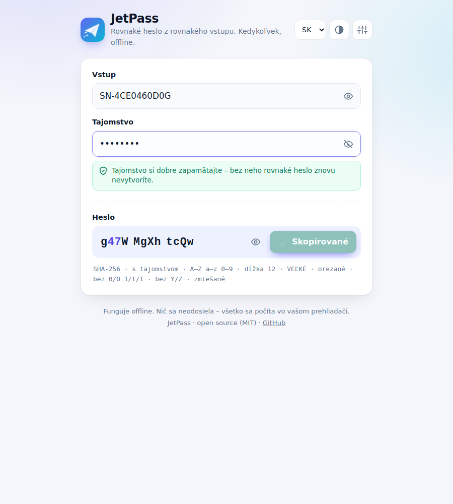

<div align="center">

# ✈️ JetPass

**The same password from the same input. Anytime, offline.**

Type a serial number, add your secret, get a strong password.
Next time, type the same things and get the same password again. Nothing to store, nothing to sync.

[**Download**](https://github.com/vrumanko/JetPass/archive/refs/heads/main.zip) · [How to use](#-how-to-use) · [Use cases](#-use-cases) · [Advanced mode](#%EF%B8%8F-advanced-mode)



</div>

---

## ✨ Why JetPass

- 🔁 **Repeatable.** The same input and secret always give the same password.
- 📴 **Offline.** One HTML file. Works without internet and sends nothing anywhere.
- 🧩 **Simple.** Two fields and a Copy button. The defaults are ready to use.
- ⌨️ **BIOS-friendly.** By default, passwords use only letters and digits, without Y and Z and without look-alike characters like `0`/`O` or `1`/`l`.
- 🌍 **Four languages.** Slovak, English, German and Spanish, plus light and dark mode.

## 🚀 How to use

1. **Download** JetPass and unzip it.
2. **Open `index.html`** by double-clicking it. It opens in your web browser.
3. Type the **input**, for example the device serial number `SN-4CE0460D0G`.
4. Type your **secret**, a word or phrase that only you know.
5. Click **Copy** and paste the password where you need it.

That's all. To get the same password later, open JetPass and type the same input and secret.

> [!IMPORTANT]
> **Always use a secret.** Without one, anyone who can see the serial number (it is often printed on a sticker) and knows JetPass can compute the same password.
> Remember your secret well. Without it, the password cannot be recreated.

> [!TIP]
> Spaces at the start and end are ignored, and lowercase letters in the input are turned into uppercase. So `sn-4ce0460d0g ` gives the same password as `SN-4CE0460D0G`.

### Default settings

You don't need to change anything. The defaults are:

| Setting | Default |
|---|---|
| Algorithm | SHA-256 of *input + secret* |
| Password | 12 characters, letters and digits |
| Always contains | at least one uppercase letter, one lowercase letter and one digit |
| Left out | `Y` `Z` (keyboard layouts) and `0 O o 1 l I` (easy to confuse) |
| Input clean-up | trim spaces, convert to UPPERCASE |

## 💡 Use cases

| Use case | Input | Result |
|---|---|---|
| 🖥️ **BIOS / UEFI password** for each computer | Device serial number | Every computer has its own password, and you only need to remember one secret. |
| 🚗 **Vehicle or device registration** | Registration number, e.g. `BA-123XY` | A unique password for fleet tools, trackers or service portals. |
| 🏷️ **Asset or repository label** | Inventory tag, e.g. `IT-2024-0815` | Passwords for labelled equipment, archives or storage boxes. |
| 📡 **Router / Wi-Fi / printer admin** | MAC address or model + location | A different admin password per device, easy to recover. |
| 🔢 **PIN codes** | Door, locker or kiosk ID | Use *Digits only* in Advanced mode for a numeric PIN. |
| 💾 **Encrypted disks and backups** | Disk label or backup name | Recreate the password years later without a password vault. |

> [!NOTE]
> JetPass is great for *many similar devices* where storing every password is impractical.
> For your personal accounts (email, banking), a password manager is still the better choice.

## 🔒 Privacy and security

- Everything is computed in your browser. JetPass makes **no network requests** (enforced by a Content Security Policy in the page).
- Your input and secret are **never saved**. Only your Advanced settings, language and theme are remembered in the browser.
- The password is only as strong as your secret. Use a long secret that is not easy to guess, such as a short sentence.

---

## ⚙️ Advanced mode

Click the **sliders icon** (top right) to open the advanced settings.
A small dot on the icon means you are not using the default settings.

> [!WARNING]
> **Every change in Advanced mode changes the generated passwords.**
> Write your settings down or save the [profile code](#profile-code), or you will not be able to recreate your passwords.

### Input clean-up

| Option | Default | What it does |
|---|---|---|
| Remove spaces at the start and end | ✅ on | `" SN123 "` → `"SN123"`. Also applies to the secret. |
| Remove all spaces and dashes | ⬜ off | `"SN-12 34"` → `"SN1234"` |
| Input letter case | UPPERCASE | *Keep*, *UPPERCASE* or *lowercase*. Applies to the input only, never to the secret. |

Text is always Unicode-normalised (NFC), so letters with accents give the same result on every system.

### Algorithm

| Algorithm | How input and secret are used | Notes |
|---|---|---|
| **SHA-256** (default) | hash of `input + separator + secret` | Fast; easy to verify with standard tools. |
| SHA-512 | same as above | Longer internal hash. |
| SHA-1 | same as above | Legacy, kept only for compatibility. |
| HMAC-SHA-256 / HMAC-SHA-512 | secret is the key, input is the message | Standard keyed hash. |
| PBKDF2-SHA-256 | secret is the password, input is the salt | Slow on purpose, which makes guessing the secret harder. **Iterations:** 1 000 – 1 000 000 (default 100 000). |

For the SHA algorithms you can also set:

- **Order**: *input + secret* (default) or *secret + input*.
- **Separator**: text placed between the two, e.g. `:`. Empty by default.

When the secret is empty, only the input is hashed.

### Output

| Option | Default | What it does |
|---|---|---|
| Characters | Letters and digits | Also available: *Uppercase + digits*, *Lowercase + digits*, *Digits only (PIN)*, *Letters, digits and symbols* (`!#$%*+-=?@_`), *Hex* and *Custom characters*. |
| Length | 12 | 4 – 64 characters. |
| Skip look-alike characters | ✅ on | Removes `0 O o` and `1 l I`, but only when the set contains more than one of a group. A PIN therefore keeps `0` and `1`. |
| Skip Y and Z | ✅ on | BIOS setup uses a US keyboard. On Slovak and German (QWERTZ) keyboards Y and Z are swapped, so a password typed at the BIOS prompt could fail. |
| At least one uppercase, lowercase and digit | ✅ on | Guarantees a mix of all character types in the chosen set (and a symbol, if the set has symbols). |
| Prefix / Suffix | empty | Fixed text added before or after the password. It is not counted in the length. |

> [!CAUTION]
> Symbols are often on different keys in the BIOS than in Windows. Avoid them for BIOS passwords.

### Display

- **Groups of 4**: shows `g47W MgXh tcQw` for easier reading and typing. The password is copied without spaces.
- **Show / hide** (eye icons): hide or show the input, secret and password. The secret is hidden by default.

### Profile code

The profile code stores all your Advanced settings in one short line, such as `JP1-eyJhbGdvIjoiU0hBLTUxMiJ9`.

- **Copy** it and keep it with your notes.
- **Paste** it on another computer and click **Apply** to get exactly the same passwords.
- The default settings have the code `JP1-e30`.
- The code never contains your input or secret.

**Restore defaults** brings back all the default settings.

### Verify a result yourself

With *Characters: Hex*, the password is the plain SHA-256 hash, so you can check it with standard tools:

```bash
echo -n "SN-4CE0460D0GMySecret" | sha256sum
```

<details>
<summary><b>How passwords are built (technical)</b></summary>

1. **Normalise:** NFC, then optional trim, strip and case change.
2. **Hash:** using the selected algorithm (see the table above). Text is encoded as UTF-8.
3. **Expand:** the hash is followed by `SHA-256(hash ‖ counter)` blocks (counter as 32-bit big-endian, starting at 1) when more bytes are needed.
4. **Map to characters:** each byte is mapped with rejection sampling (bytes ≥ `256 − 256 mod n` are skipped), so every character is equally likely. *Hex* uses the bytes directly.
5. **Mix rule:** if the password lacks a required character type, the next `length` characters from the stream are tried.
6. **Add prefix and suffix.**

All hash functions are implemented in plain JavaScript inside `index.html` and are tested against Node.js crypto.
PBKDF2 uses the browser's built-in Web Crypto when available.

</details>

---

## 🛠️ For developers

JetPass is one file, `index.html`, with no dependencies and no build step.

```bash
node tests/run.mjs           # hash functions vs Node crypto + frozen password vectors
node tests/run.mjs --update  # rewrite tests/vectors.json (only for intended output changes)
```

`tests/vectors.json` makes sure that generated passwords **never change** between versions. If a test vector fails, your change would break every user's existing passwords.

Contributions are welcome. Translations live in the `I18N` object in `index.html`.

## 📄 License

[MIT](LICENSE) © vrumanko
